<p align="center">
  
</p>

<p align="center">
  First-year B.Tech student in Artificial Intelligence & Data Science.<br>
  I build local-first AI systems: voice interfaces, LLM tooling, and the security around them.
</p>

<p align="center">
  <a href="https://www.linkedin.com/in/rehaantaherbhoy/"></a>
  <a href="https://github.com/Rehaan15790?tab=repositories"></a>
  
</p>

```text
rehaan@github ~ $ whoami --verbose
┌─[ REHAAN TAHERBHOY ]───────────────────────────────────────────┐
│ study     B.Tech, Artificial Intelligence & Data Science, yr 1 │
│ builds    local-first AI: voice, LLM tooling, agents           │
│ cares     the security around them                             │
│ writes    Python · Go · JavaScript · TypeScript                │
└────────────────────────────────────────────────────────────────┘
```

## Projects

<table>
  <tr>
    <td width="50%" valign="top">
      <a href="https://github.com/Rehaan15790/Belphegor"></a>
      <h3><a href="https://github.com/Rehaan15790/Belphegor">Belphegor</a></h3>
      <p>A self-hosted console where LLM agents run penetration tests against targets you are authorized to test. Intercept rules and approvals gate every tool call, and a recording proxy can capture the traffic as evidence.</p>
      <p><sub>Go · Next.js · PostgreSQL · Docker</sub></p>
    </td>
    <td width="50%" valign="top">
      <a href="https://github.com/Rehaan15790/ultron"></a>
      <h3><a href="https://github.com/Rehaan15790/ultron">ultron</a></h3>
      <p>A local voice-driven AI assistant with a command-center interface. The model sits downstream of every security decision: sanitizer, deterministic router, tiered permission gate, audit log.</p>
      <p>
        <a href="https://github.com/Rehaan15790/ultron/actions/workflows/tests.yml"></a>
        <a href="https://github.com/Rehaan15790/ultron/releases"></a>
      </p>
      <p><sub>Python · FastAPI · Ollama · faster-whisper · ElevenLabs · 111 tests, 37 of them sandbox-escape attempts</sub></p>
    </td>
  </tr>
  <tr>
    <td width="50%" valign="top">
      <a href="https://github.com/Rehaan15790/OceanLens-3D"></a>
      <h3><a href="https://github.com/Rehaan15790/OceanLens-3D">OceanLens 3D</a></h3>
      <p>An interactive 3D viewer for ocean model output and Argo floats, in one offline HTML file. Slice, probe and compare model fields with float observations and a cyclone track. Built with Team ByteForge for Smart India Hackathon 2026.</p>
      <p>
        <a href="https://github.com/Rehaan15790/OceanLens-3D/actions/workflows/ci.yml"></a>
        
      </p>
      <p><sub>JavaScript · three.js · Python · NumPy · OGC WMS / WCS / OPeNDAP data server</sub></p>
    </td>
    <td width="50%" valign="top">
      <a href="https://github.com/Rehaan15790/productivity-app"></a>
      <h3><a href="https://github.com/Rehaan15790/productivity-app">Productivity app</a></h3>
      <p>Timetable, attendance, deadlines, a focus timer, gym, food and daily goals in one app that installs on a phone or laptop. It works offline and keeps your data on your device.</p>
      <p><a href="https://rehaan15790.github.io/productivity-app/"></a></p>
      <p><sub>HTML · JavaScript · installable web app · service worker · localStorage</sub></p>
    </td>
  </tr>
</table>

## GitHub activity

<p align="center">
  
</p>
<p align="center">
  
</p>
<p align="center">
  
</p>

<p align="center"><sub>Cards are drawn by <a href="scripts/cards.py">scripts/cards.py</a> and refreshed daily by a GitHub Action.</sub></p>

## Focus

- **Local-first AI.** Models, speech and data stay on the machine.
- **AI security.** Sandboxing, prompt-injection defences, permission gates, audit trails.
- **Data and visualisation.** Turning scientific data into something you can explore.

## Stack

<table>
  <tr>
    <td><b>Languages</b></td>
    <td>
      
      
      
      
      
    </td>
  </tr>
  <tr>
    <td><b>AI &amp; voice</b></td>
    <td>
      
      
      
      
    </td>
  </tr>
  <tr>
    <td><b>Web &amp; 3D</b></td>
    <td>
      
      
      
    </td>
  </tr>
  <tr>
    <td><b>Data &amp; infra</b></td>
    <td>
      
      
      
      
      
      
      
    </td>
  </tr>
</table>
