  

  First-year B.Tech student in Artificial Intelligence & Data Science. 
  I build local-first AI systems: voice interfaces, LLM tooling, and the security around them.

  
  

  

## Projects

<table>
  <tr>
    <td width="50%" valign="top">
      
      <h3><a href="https://github.com/Rehaan15790/Belphegor">Belphegor</a></h3>
      
A self-hosted console where LLM agents run penetration tests against targets you are authorized to test. Intercept rules and approvals gate every tool call, and a recording proxy can capture the traffic as evidence.

      
Go · Next.js · PostgreSQL · Docker

    </td>
    <td width="50%" valign="top">
      
      <h3><a href="https://github.com/Rehaan15790/ultron">ultron</a></h3>
      
A local voice-driven AI assistant with a command-center interface. The model sits downstream of every security decision: sanitizer, deterministic router, tiered permission gate, audit log.

      

        
        
      

      
Python · FastAPI · Ollama · faster-whisper · ElevenLabs · 111 tests, 37 of them sandbox-escape attempts

    </td>
  </tr>
  <tr>
    <td width="50%" valign="top">
      
      <h3><a href="https://github.com/Rehaan15790/OceanLens-3D">OceanLens 3D</a></h3>
      
An interactive 3D viewer for ocean model output and Argo floats, in one offline HTML file. Slice, probe and compare model fields with float observations and a cyclone track. Built with Team ByteForge for Smart India Hackathon 2026.

      

        
        
      

      
JavaScript · three.js · Python · NumPy · OGC WMS / WCS / OPeNDAP data server

    </td>
    <td width="50%" valign="top">
      
      <h3><a href="https://github.com/Rehaan15790/productivity-app">Productivity app</a></h3>
      
Timetable, attendance, deadlines, a focus timer, gym, food and daily goals in one app that installs on a phone or laptop. It works offline and keeps your data on your device.

      

      
HTML · JavaScript · installable web app · service worker · localStorage

    </td>
  </tr>
</table>

## GitHub activity

  

  

  

## Stack

  

Cards and badges are drawn by <a href="scripts/cards.py">scripts/cards.py</a> and refreshed daily by a GitHub Action; the CI status badges come from GitHub. Icons from <a href="https://simpleicons.org">Simple Icons</a> (CC0).

